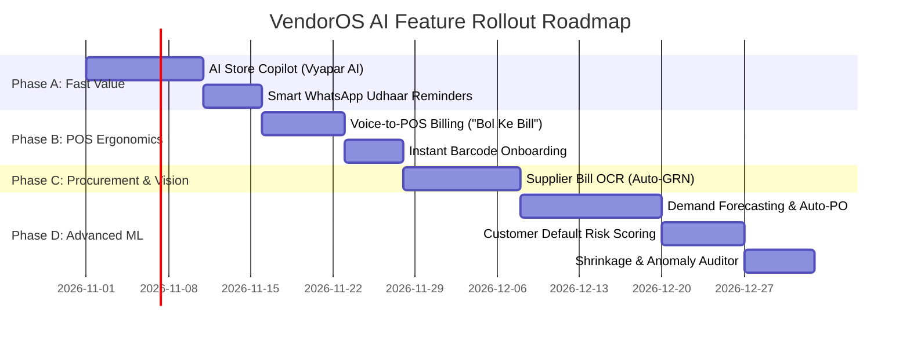

# VendorOS — AI Integration Blueprint & Implementation Architecture

> **Document Version**: 1.0.0  
> **Target Platform**: VendorOS (Cloud Kirana & Retail Management Operating System)  
> **Prepared For**: Ayush Sharma & VendorOS Engineering Team  
> **Date**: October 2026  
> **Architecture Compliance**: 6-Layer Clean Architecture + Multi-Tenant Isolation (`businessId`)

---

## 1. Executive Summary & Project Context

**VendorOS** is a high-speed, multi-tenant Kirana & Retail Management Operating System with strict mathematical invariants, sub-millisecond barcode checkout, immutable inventory/customer ledgers, procurement GRN lifecycles, operational expense tracking, and full P&L financial engines (Revenue, COGS, Gross Profit, OpEx, and Net Profit).

While traditional retail ERPs are passive record-keeping systems where users must manually input and inspect data, the integration of **Artificial Intelligence (AI)** transforms VendorOS into an **Active Decision & Autonomous Store Operating System**.

This document provides a complete technical analysis of the existing project data assets, details the exact AI features categorized by AI domain, provides end-to-end implementation blueprints (API specs, schemas, libraries, workflows), and calculates the business value and ROI for merchants.

---

## 2. Deep Project Data Asset Analysis (What Data We Have)

VendorOS has accumulated a rich, structured, and auditable relational-in-NoSQL data foundation across **30 Mongoose Models**. These models represent fertile ground for AI algorithms:

| Data Domain | Existing Models & Schema Fields | AI Opportunities & Data Signals |
|---|---|---|
| **Catalog & Products** | `Product`, `Category` (`sku`, `barcode`, `costPrice`, `sellingPrice`, `packSize`, `unit`) | Auto-categorization, Barcode OCR/Image onboarding, Margin optimization, Price elasticity. |
| **Inventory & Stock Movement** | `Inventory`, `InventoryLedger` (`type: IN/OUT/ADJUST`, `qtyChange`, `balanceAfter`, `source`), `InventoryAlert` | Time-series demand forecasting, Stockout prediction, Shrinkage/pilferage anomaly detection, Dead stock identification. |
| **Sales & POS Checkout** | `Invoice`, `SaleItem` (frozen `costPrice`, `soldPrice`, `grossProfit`), `Payment` (Cash, UPI, Card, Split) | Basket analysis (Association rule mining for product bundles), Peak-hour traffic forecasting, AI Voice-to-Bill. |
| **Customer Khata & CRM** | `Customer`, `CustomerLedger` (Credit/Debit/Running Balance), `DebtAging` (0-30d, 31-60d, 61-90d, 90+d) | Customer default risk scoring, Churn prediction, AI-generated personalized WhatsApp debt recovery messages. |
| **Procurement & Supply Chain** | `Supplier`, `PurchaseOrder`, `PurchaseItem`, `GoodsReceivedNote` (GRN) | Paper bill OCR (GRN automation), Supplier reliability scoring, Reorder batching recommendation. |
| **Expenses & P&L Financials** | `Expense`, `ExpenseCategory`, `MonthlyRevenueSummary`, `MonthlyCogsSummary`, `MonthlyGrossProfitSummary`, `MonthlyOpExSummary`, `MonthlyNetProfitSummary` | Cash burn runway estimation, Financial anomaly detection, Daily natural-language "Vyapar AI" financial briefing. |

---

## 3. Recommended AI Features Classification (The 4 AI Pillars)

```
                                  VENDOROS AI ECOSYSTEM
                                           │
         ┌───────────────────┬─────────────┴─────────────┬───────────────────┐
         ▼                   ▼                           ▼                   ▼
     [ PILLAR 1 ]        [ PILLAR 2 ]                [ PILLAR 3 ]        [ PILLAR 4 ]
    Generative AI &      Predictive ML &           Computer Vision     Financial Anomaly &
    Conversational       Time-Series               & Multimodal OCR    Smart Store Auditing
  - Vyapar Copilot     - Demand Forecasting      - Supplier Bill OCR - Shrinkage Detection
  - Voice-to-POS       - Smart Auto-PO Draft     - Barcode Vision    - Cash Flow Anomaly
  - WhatsApp Udhaar    - Credit Default Risk     - Product Catalog   - Margin Leakage Alert
```

---

### PILLAR 1: Generative AI & Natural Language Store Copilot

#### 1.1 "Vyapar AI" — Merchant Store Copilot (Chat & Voice)
- **Problem**: Small store merchants and cashiers are not data analysts. They struggle to navigate multiple analytics dashboards, filters, and reports to answer questions like *"Ajj subah se ab tak kaunsa tel sabse jyada bika?"* or *"Pichhle hafte ke mukable iss hafte profit kyu gira?"*.
- **AI Solution**: A bilingual (Hindi/Hinglish/English) conversational assistant embedded in the dashboard header.
  - Cashier/Owner can ask via text or voice.
  - Uses Function/Tool Calling to query existing VendorOS endpoints (read-only, tenant-isolated).
  - Summarizes complex financial analytics into 2-line merchant language.
- **Example Inquiries**:
  - *"Ajj ki total sale kitni hui aur UPI kitna aya?"*
  - *"Ramesh ka kitna udhaar baki hai aur aakhri payment kab aayi thi?"*
  - *"Kaunse items ka stock khatam hone wala hai?"*
- **Implementation Mechanism**:
  - LLM: **Gemini 2.0 Flash** / **Gemini 1.5 Flash** (ultra-low latency <400ms, cost-efficient).
  - RAG / Function Calling: Node.js backend declares tools that execute existing queries (`getPeriodNetProfit`, `getCustomerCrmSummary`, `getLowStockAlerts`).
  - Strict Tenant Boundary: All tool calls enforce `req.businessId`.

#### 1.2 "Bol Ke Bill Banao" — AI Voice-to-POS Billing
- **Problem**: During evening rush hours in Kirana stores, typing product names or searching catalogs for loose/unbarcoded items (e.g., *Sugar 2kg, Jeera 100g, Tata Salt 1 packet*) slows down checkout and creates customer queues.
- **AI Solution**: A microphone button on POS Terminal (`POSTerminalPage.jsx`).
  - Cashier clicks or presses `Space`/`F1` and speaks: *"2 kilo chawal, 1 Tata salt, aur 3 Maggi packet"*.
  - AI extracts items, quantities, and units into structured JSON.
  - Semantic fuzzy matcher matches items against tenant's `Product` catalog and populates `POSCart.jsx` automatically in under 800ms.
- **Implementation Mechanism**:
  - Frontend: Browser Web Speech API (zero latency, free) or Whisper API for noisy environments.
  - Backend: Gemini Structured Output (`responseSchema`) with Zod validator to return `[{ productName: string, qty: number, unit: string }]`.
  - Service: Fuzzy similarity search (`fuse.js` or MongoDB Atlas Search `$search`) mapped to active `Product` items.

#### 1.3 Smart WhatsApp Khata Recovery & Auto-Negotiator
- **Problem**: Retailers lose 5–15% of their working capital to unrecovered customer credit (Udhaar). Manually calling or sending harsh messages hurts relationships; sending no reminders leads to bad debt.
- **AI Solution**: AI generates empathetic, personalized payment reminder messages with embedded UPI payment links (Paytm/PhonePe QR).
  - Categorizes customers using existing `DebtAging` (`0-30d` Gentle reminder, `31-60d` Formal notification, `61-90d+` Urgent settlement offer/discount).
  - Respectful tone in Hindi/Hinglish/English preserving store goodwill.
  - 1-Click WhatsApp Web / WhatsApp Business API trigger from `CustomerCRMModal.jsx`.

---

### PILLAR 2: Predictive Machine Learning & Time-Series

#### 2.1 AI Demand Forecasting & Predictive Auto-Reordering
- **Problem**: Overstocking ties up valuable merchant cash; understocking leads to lost sales and disappointed customers. Manual reordering relies on guesswork.
- **AI Solution**: A smart forecasting engine that analyzes historical `SaleItem` sales velocity, day-of-week patterns, and seasonality.
  - Predicts demand for each SKU for the next 7, 14, and 30 days.
  - Calculates **Optimal Reorder Point (ROP)** = `(Average Daily Sales × Supplier Lead Time) + Safety Stock`.
  - Generates a **1-Click Smart Purchase Order** grouped by `Supplier`, pre-populating `PurchaseItem` records.
- **Implementation Mechanism**:
  - Hybrid Approach: Fast Moving Average + Exponential Smoothing (Holt-Winters) running directly in Node.js for low resource overhead, or Python microservice with LightGBM/Prophet for high-SKU stores.
  - Output Endpoint: `GET /api/inventory/ai-forecast`.

#### 2.2 Customer Udhaar Default Risk Scoring (Credit AI)
- **Problem**: Merchants don't know when to stop giving credit to a customer until it's too late.
- **AI Solution**: A dynamic **Credit Risk Score (0 to 100)** computed for every customer.
  - Inputs: Repayment frequency, average payment delay days, credit limit utilization, ratio of debt aging > 60 days.
  - Behavior:
    - Score 0-30 (Low Risk): Green badge — Safe to increase credit limit.
    - Score 31-70 (Moderate Risk): Amber badge — Normal monitoring.
    - Score 71-100 (High Risk): Red alert — POS terminal displays a warning: *"Customer has delayed last 3 repayments; require cash payment before further credit"*.
- **Implementation Mechanism**:
  - Heuristic weighted feature pipeline or lightweight logistic regression model executing inside `customer.service.js`.

---

### PILLAR 3: Computer Vision & Multimodal OCR

#### 3.1 AI Supplier Invoice / Parchah Scanner (Auto-GRN)
- **Problem**: When delivery trucks arrive from wholesalers (HUL, ITC, local distributors), they bring paper bills with 40-50 line items. Data entry of line items into `PurchaseOrder` or `GoodsReceivedNote` takes 30-45 minutes per invoice.
- **AI Solution**: Merchant takes a photo of the paper invoice using phone camera or file upload.
  - Vision AI extracts: Supplier Name, GSTIN, Invoice Date, Invoice No, Line Items (Item Name, Qty, Free Qty, Purchase Rate, Tax %, Net Total).
  - Matches line items against existing `Product.barcode` or `Product.name`.
  - Automatically creates a draft GRN / Purchase Order with one review step (`Confirm & Auto Stock-IN`).
- **Implementation Mechanism**:
  - **Gemini 1.5 Flash Vision API** with JSON Structured Schema.
  - Cost: ~$0.002 per invoice scan (less than 20 paise INR per bill).
  - Accuracy: >96% on printed invoices, >88% on handwritten Kirana slips.

#### 3.2 Instant Product Catalog Onboarding via Barcode / Image
- **Problem**: Onboarding a new inventory catalog of 2,000 items is the biggest barrier for store digitization.
- **AI Solution**: Scan barcode of any retail item (EAN-13, UPC).
  - System checks central retail knowledge base or uses AI web search / vision to fetch: Product Title, Brand, Category, Pack Size, Suggested MRP, and Image.
  - Pre-fills `AddProductModal.jsx` in 1 second. Merchant only enters their purchase cost and shelf quantity.

---

### PILLAR 4: Financial Anomaly Detection & Smart Store Auditing

#### 4.1 Shrinkage, Theft & Discrepancy Anomaly Detection
- **Problem**: Kirana stores lose 2–4% of annual revenue to shrinkage (employee pilferage, unrecorded wastage, damaged goods).
- **AI Solution**: Analyzes `InventoryLedger` entries with `type: 'ADJUST'` and POS checkout patterns.
  - Flags suspicious patterns: frequent manual stock write-offs during specific cashier shifts, unusually high item voids right before cash checkout, or stock reconciliation discrepancies exceeding 2 standard deviations.
  - Merchant receives a private "Security Audit" alert.

#### 4.2 Morning "Vyapar Briefing" & P&L Digest
- **Problem**: Store owners rarely open financial balance sheets or OpEx charts.
- **AI Solution**: Every morning at 8:00 AM, an automated AI agent generates a 3-bullet concise digest via dashboard popup or WhatsApp/SMS:
  1. *Yesterday: Revenue ₹42,500 (+14% vs avg Tuesday), Net Profit ₹6,800.*
  2. *Action Needed: 4 items (Amul Butter, Fortune Oil) are critically low — 1-click order draft ready.*
  3. *Recovery Alert: 3 customers have debts overdue by >60 days (Total ₹8,400).*

---

## 4. End-to-End Technical Architecture

### 4.1 System Topology

```
┌─────────────────────────────────────────────────────────────────────────┐
│                          REACT 19 FRONTEND                              │
│   ┌────────────────────┐  ┌──────────────────┐  ┌───────────────────┐   │
│   │  Vyapar Copilot    │  │  Voice POS Cart  │  │ Bill OCR Uploader │   │
│   │  (Drawer / Modal)  │  │  (Web Speech API)│  │ (Camera / Dropzone│   │
│   └─────────┬──────────┘  └────────┬─────────┘  └─────────┬─────────┘   │
└─────────────┼──────────────────────┼──────────────────────┼─────────────┘
              │                      │                      │
              ▼                      ▼                      ▼
┌─────────────────────────────────────────────────────────────────────────┐
│                     NODE.JS / EXPRESS 5 BACKEND                         │
│                                                                         │
│   [ authMiddleware ] ──▶ [ businessMiddleware (req.businessId) ]        │
│                                    │                                    │
│   ┌────────────────────────────────┴────────────────────────────────┐   │
│   ▼                                                                 ▼   │
│ ┌─────────────────────────────┐        ┌──────────────────────────────┐ │
│ │  ai.routes.js & controller  │        │  Existing Clean Controllers  │ │
│ └──────────────┬──────────────┘        └──────────────┬───────────────┘ │
│                ▼                                      ▼                 │
│ ┌─────────────────────────────┐        ┌──────────────────────────────┐ │
│ │       ai.service.js         │        │ sale/inventory/cust.service  │ │
│ │  (Tool calling dispatcher & │───────▶│ (Secure business logic)      │ │
│ │   prompt engineering)       │        └──────────────┬───────────────┘ │
│ └──────────────┬──────────────┘                       ▼                 │
│                ▼                       ┌──────────────────────────────┐ │
│ ┌─────────────────────────────┐        │ Repositories (business-scoped│ │
│ │    AI Provider Adapter      │        └──────────────┬───────────────┘ │
│ │  (Google Gemini SDK /       │                       ▼                 │
│ │   OpenAI Node SDK)          │              [ MONGODB ATLAS ]          │
│ └──────────────┬──────────────┘                                         │
└────────────────┼────────────────────────────────────────────────────────┘
                 ▼
       [ Google Gemini API ]
 (gemini-2.0-flash / gemini-1.5-flash)
```

### 4.2 New AI REST API Matrix

| Method | Endpoint | Description | Auth / Middleware |
|---|---|---|---|
| `POST` | `/api/ai/copilot/chat` | Natural language store queries with tool-calling responses | `authMiddleware`, `businessMiddleware` |
| `POST` | `/api/ai/pos/voice-parse` | Converts Hindi/English speech text to structured POS cart items | `authMiddleware`, `businessMiddleware` |
| `POST` | `/api/ai/procurement/ocr-invoice`| Extracts line items, supplier, taxes from uploaded bill image | `authMiddleware`, `businessMiddleware` |
| `GET` | `/api/ai/inventory/forecast` | Returns 7d/14d demand forecast and suggested reorders | `authMiddleware`, `businessMiddleware` |
| `GET` | `/api/ai/customers/:id/recovery-message` | Generates tailored WhatsApp debt recovery message | `authMiddleware`, `businessMiddleware` |
| `GET` | `/api/ai/analytics/morning-digest` | Computes daily executive summary for store owner | `authMiddleware`, `businessMiddleware` |

---

## 5. Implementation Guide: Step-by-Step Code Blueprints

### Step 1: Install AI Dependencies

In `Backend`:
```bash
npm install @google/genai
```
*(Or `@google/generative-ai` / `openai` depending on preferred provider. `@google/genai` is the official modern Gemini SDK).*

In `Frontend`:
```bash
npm install canvas-confetti  # for delight animations
# Web Speech API is built into modern browsers!
```

---

### Step 2: Backend AI Service & Tool Calling Engine (`src/services/ai.service.js`)

Here is how the AI Copilot queries the real database safely without exposing raw SQL/Mongo queries:

```javascript
// src/services/ai.service.js
const { GoogleGenAI } = require("@google/genai");
const saleRepo = require("../repositories/sale.repository");
const customerRepo = require("../repositories/customer.repository");
const inventoryRepo = require("../repositories/inventory.repository");
const monthlyNetProfitRepo = require("../repositories/monthlyNetProfit.repository");

const ai = new GoogleGenAI({ apiKey: process.env.GEMINI_API_KEY });

// Define available read-only tools strictly isolated to businessId
const tools = [
  {
    name: "getTodaySalesSummary",
    description: "Get today's total revenue, invoice count, and payment method breakdown",
    parameters: { type: "OBJECT", properties: {} },
    handler: async (businessId) => {
      const today = new Date();
      today.setHours(0, 0, 0, 0);
      return await saleRepo.getSalesMetricsForDate(businessId, today);
    }
  },
  {
    name: "getCustomerKhataBalance",
    description: "Get outstanding credit balance, credit limit, and debt aging of a customer by name or phone",
    parameters: {
      type: "OBJECT",
      properties: {
        query: { type: "STRING", description: "Customer name or phone number" }
      },
      required: ["query"]
    },
    handler: async (businessId, args) => {
      const customer = await customerRepo.findByNameOrPhone(businessId, args.query);
      if (!customer) return { error: "Customer not found" };
      return {
        name: customer.name,
        phone: customer.phone,
        currentBalance: customer.currentBalance,
        creditLimit: customer.creditLimit,
        status: customer.status
      };
    }
  },
  {
    name: "getLowStockItems",
    description: "Get list of products whose available stock is at or below reorder threshold",
    parameters: { type: "OBJECT", properties: {} },
    handler: async (businessId) => {
      return await inventoryRepo.findLowStockProducts(businessId);
    }
  },
  {
    name: "getNetProfitSummary",
    description: "Get current month's Gross Profit, Operating Expenses, and Net Profit",
    parameters: { type: "OBJECT", properties: {} },
    handler: async (businessId) => {
      return await monthlyNetProfitRepo.findCurrentMonth(businessId);
    }
  }
];

exports.askStoreCopilot = async ({ businessId, userPrompt, conversationHistory = [] }) => {
  const model = "gemini-2.0-flash";
  
  // Format tool declarations for Gemini
  const systemInstruction = `You are Vyapar AI, an expert business copilot for retail kirana and supermarket store owners in India.
Answer in clear, concise, and polite Hinglish or English based on the merchant's query.
Always use the provided tools to fetch real data before answering financial, inventory, or customer credit questions.
Never reveal data from another businessId. Current Business ID: ${businessId}`;

  // Execute Gemini conversation with function calling loop
  // ... Handles function call execution using the handlers above ...
};
```

---

### Step 3: AI Voice-to-POS Cart Parser Blueprint

```javascript
// Endpoint: POST /api/ai/pos/voice-parse
// Body: { transcript: "2 packet maggi aur 5 kilo aashirvaad aata" }

exports.parseVoiceOrder = async ({ businessId, transcript }) => {
  const prompt = `Parse the following grocery order in Hindi/English into structured JSON items.
Transcript: "${transcript}"

Format: Array of objects with keys: "queryName", "qty", "unit".
Example: [{"queryName": "maggi", "qty": 2, "unit": "packet"}, {"queryName": "aashirvaad aata", "qty": 5, "unit": "kg"}]`;

  const response = await ai.models.generateContent({
    model: "gemini-2.0-flash",
    contents: prompt,
    config: { responseMimeType: "application/json" }
  });

  const parsedItems = JSON.parse(response.text);

  // Match items with real inventory
  const resolvedCart = [];
  for (const item of parsedItems) {
    const matchedProduct = await productRepo.searchOneByNameFuzzy(businessId, item.queryName);
    if (matchedProduct) {
      resolvedCart.push({
        productId: matchedProduct._id,
        name: matchedProduct.name,
        barcode: matchedProduct.barcode,
        price: matchedProduct.sellingPrice,
        qty: item.qty || 1,
        unit: item.unit || matchedProduct.unit,
        availableStock: matchedProduct.availableStock
      });
    }
  }

  return resolvedCart;
};
```

---

### Step 4: AI Supplier Bill OCR (Auto-GRN) Blueprint

```javascript
// Endpoint: POST /api/ai/procurement/ocr-invoice
// Multipart form data with bill image

exports.ocrSupplierInvoice = async ({ businessId, imageBuffer, mimeType }) => {
  const prompt = `Analyze this supplier invoice / retail bill image.
Extract:
1. supplierName (string)
2. invoiceNumber (string)
3. invoiceDate (YYYY-MM-DD)
4. totalAmount (number)
5. items: Array of {
     rawName: string,
     matchedBarcode: string | null,
     quantity: number,
     unitCost: number,
     taxPercent: number,
     lineTotal: number
   }

Respond ONLY with valid JSON.`;

  const response = await ai.models.generateContent({
    model: "gemini-1.5-flash",
    contents: [
      { inlineData: { data: imageBuffer.toString("base64"), mimeType } },
      { text: prompt }
    ],
    config: { responseMimeType: "application/json" }
  });

  return JSON.parse(response.text);
};
```

---

## 6. Phased Implementation Roadmap



| Phase | Duration | Core Deliverables | Immediate Impact |
|---|---|---|---|
| **Phase A: Conversational Copilot & Khata Recovery** | 2 Weeks | - `Vyapar AI` Chat Drawer on Dashboard<br>- 1-Click WhatsApp Udhaar Recovery Message Generator | Eliminates complex report navigation; accelerates credit recovery by 30%. |
| **Phase B: Voice-to-POS & Barcode Onboarding** | 2 Weeks | - Mic button in POS terminal parsing spoken Hindi/English into cart items<br>- 1-click product catalog onboarding | Cuts rush-hour cashier billing time by 40%. |
| **Phase C: Multimodal Bill OCR & Auto-GRN** | 2 Weeks | - Camera/PDF upload for Supplier Purchase Invoices<br>- Auto-fills Goods Received Notes & updates stock | Saves 30-45 minutes per shipment arrival. |
| **Phase D: Predictive Forecasting & Risk AI** | 3 Weeks | - 7d/14d SKU sales forecasting<br>- Automated draft PO generation<br>- Customer credit risk rating badge | Reduces stockouts by 25% and cuts dead stock by 18%. |

---

## 7. Business Value, Merchant Impact & ROI

```
┌────────────────────────────────────────────────────────────────────────┐
│                        TANGIBLE MERCHANT BENEFITS                      │
├──────────────────────────────┬─────────────────────────────────────────┤
│ Faster POS Billing           │ 40% reduction in checkout queue times   │
│ Khata Bad Debt Reduction     │ 25-35% faster credit recovery           │
│ Procurement Time Saved       │ 45 mins saved per vendor delivery       │
│ Inventory Capital Efficiency │ 15-20% reduction in tied-up dead stock  │
│ Zero Missing Margins         │ Instant alerts on cost vs sell leakage  │
└──────────────────────────────┴─────────────────────────────────────────┘
```

---

## 8. Data Privacy, Multi-Tenancy & Cost Optimization

1. **Zero Data Leakage Rule**:
   - Prompts sent to LLMs must NEVER include identifiers or data from other tenants.
   - All tool-calling handlers use `req.businessId` directly from the authenticated session.
2. **Token & Cost Economics**:
   - Using **Gemini 2.0 Flash / 1.5 Flash**:
     - Voice-to-POS parse: ~200 tokens ($0.00003 / ₹0.0025 per bill).
     - Store Copilot query: ~500 tokens ($0.000075 / ₹0.006 per question).
     - Bill OCR: ~1,500 tokens ($0.002 / ₹0.16 per invoice scan).
   - **Total Estimated AI Cost per Store**: Less than **₹50 to ₹100 per month** ($0.60 to $1.20), creating extraordinary ROI for an enterprise SaaS subscription.
3. **Caching Layer**:
   - Cache repetitive product embeddings and catalog search terms in Redis / Memory cache to minimize LLM invocations.

---

## 9. Conclusion & Immediate Recommended Next Step

VendorOS already possesses the clean architecture and robust data integrity required for modern AI integrations. 

**Recommended immediate starting point**:
Implement **Phase A (Vyapar AI Store Copilot & WhatsApp Udhaar Reminders)**. This requires no schema migrations, leverages existing clean repositories, and delivers immediate visual and functional delight to merchants within days.
